<div align="center">

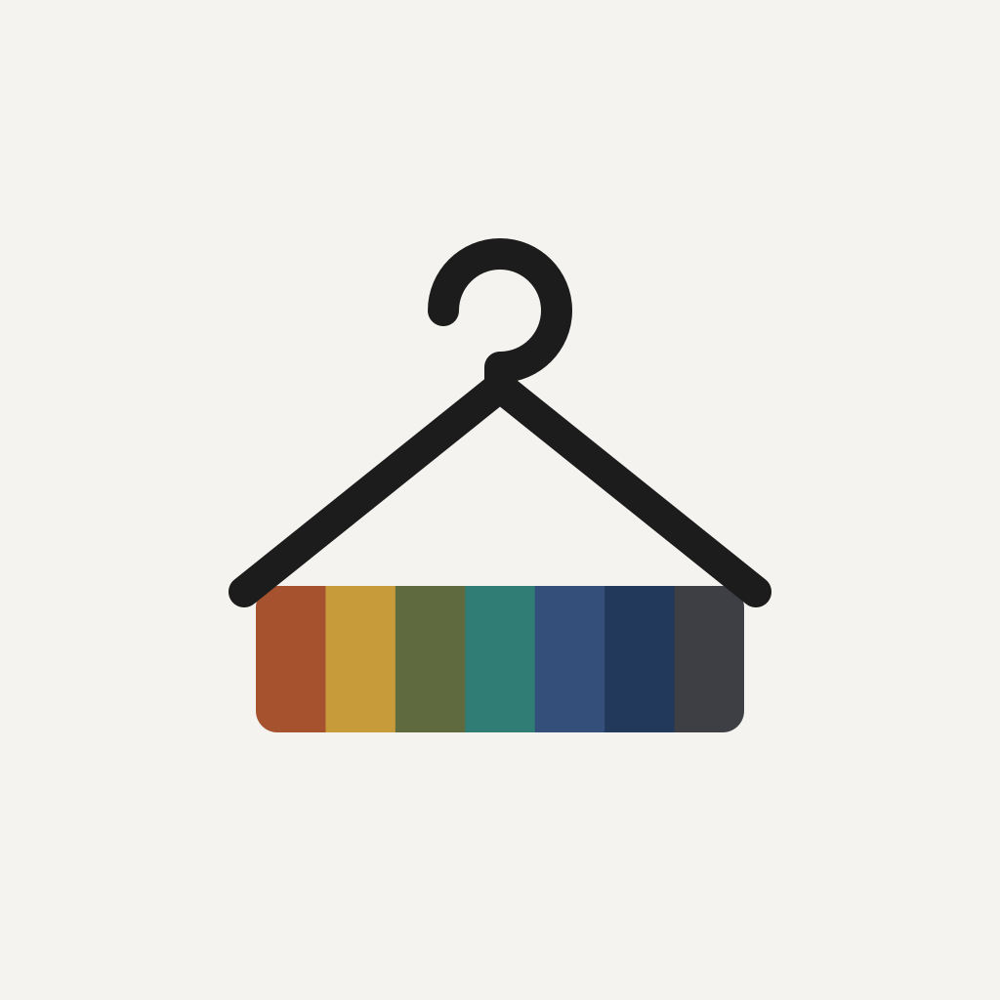

# Wardro

**Your wardrobe, photographed, sorted and styled — on your own server.**

[](https://nextjs.org)
[](https://www.postgresql.org)
[](docker-compose.yml)
[](https://tailscale.com)
[](#-android-app)
[](#-iphone-and-ipad)
[](https://www.anthropic.com)
<br />
[](CHANGELOG.md)
[](#-access-and-privacy)
[](LICENSE)
[](https://ko-fi.com/crystaxit)

<br />

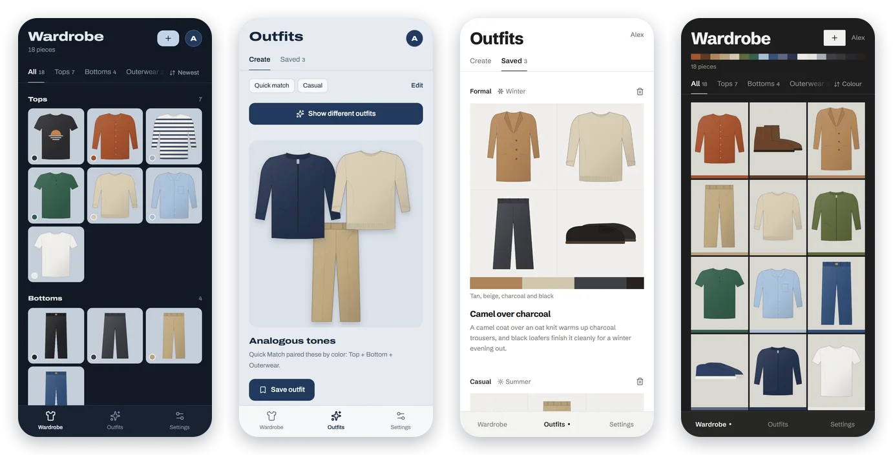

</div>

---

Photograph your clothes, and Wardro cuts each piece out of the background,
picks out its colour and files it away. Then it puts outfits together for
you — instantly from colour theory, or with an AI stylist that knows the
occasion and the weather. It runs as a few Docker containers on your own
machine and is reached over your own [Tailscale](https://tailscale.com)
network, from a browser, the Android app, or your iPhone's home screen.
Everyone in the household gets their own profile.

## ✨ Features

| | |
|---|---|
| 👕 **Digital wardrobe** | Take a photo or pick several from the gallery; Wardro removes the background (server-side, with [rembg](https://github.com/danielgatis/rembg)), tags the dominant colour, and files the piece under Top / Bottom / Outerwear / Shoes |
| 🎨 **Quick Match** | Free, fully offline outfit generator that ranks combinations by colour harmony — a curated [Sanzo Wada](https://en.wikipedia.org/wiki/Sanzo_Wada) palette blended with a hue-distance model |
| 🤖 **AI Stylist** | Sends your wardrobe photos to Claude with the occasion (Casual / Smart Casual / Formal / Evening), season and live weather, and gets back curated combinations with the reasoning behind each |
| 🧳 **Packing List** | Plans one outfit per day for a trip (up to two weeks), using each day's forecast at your destination |
| 👥 **Profiles** | "Who's getting dressed?" — each person picks their name and gets their own wardrobe, saved outfits and appearance; no passwords |
| 🪞 **Two looks** | *Tailor's navy* or *Colour story*, each in light and dark, chosen per profile |
| ⭐ **Saved outfits** | Keep the combinations you like |
| 🌦️ **Weather** | Optional, via [Open-Meteo](https://open-meteo.com) — your location or any city you type, no API key needed |

## 🪞 Two looks

Pick one per profile in **Settings**. Both come in light and dark.

<table>
  <tr>
    <th width="50%">Tailor's navy</th>
    <th width="50%">Colour story</th>
  </tr>
  <tr>
    <td>Navy and shirting blue with wide, label-style headings. The wardrobe is laid out in category rails, and every outfit is shown as a stylist's <b>flat-lay</b> — the pieces together on one board.</td>
    <td>Plain gallery screens where your clothes' own colours lead: a <b>spectrum</b> of everything you own, sort-by-colour, and each outfit's palette as a <b>colour band</b> with plain names ("tan, beige, charcoal and black").</td>
  </tr>
  <tr>
    <td align="center">
      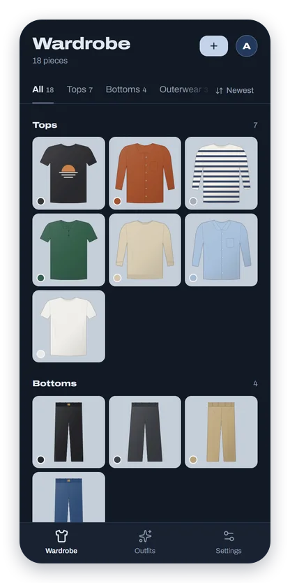
      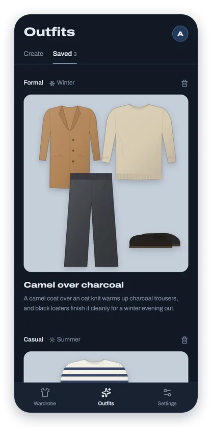
    </td>
    <td align="center">
      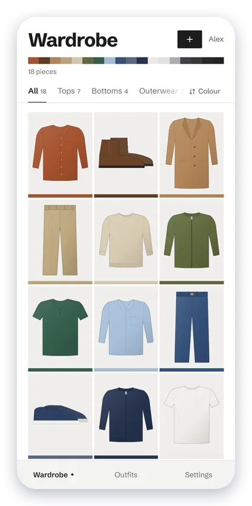
      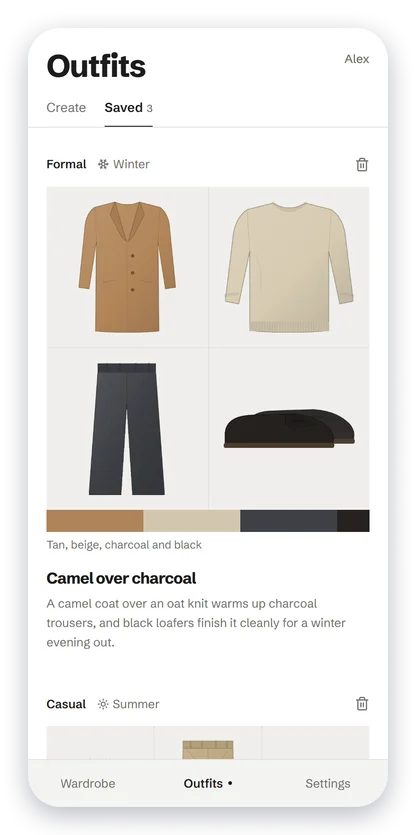
    </td>
  </tr>
</table>

## 👥 Profiles

Wardro has no logins — whoever is on your tailnet can open it — but a
household can share one server: each person picks their profile by name,
and every profile has its own wardrobe, saved outfits, look and theme. Each
device remembers its profile until you switch (tap your avatar or name).

<p align="center">
  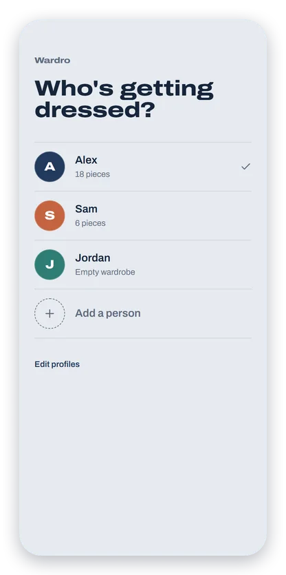
  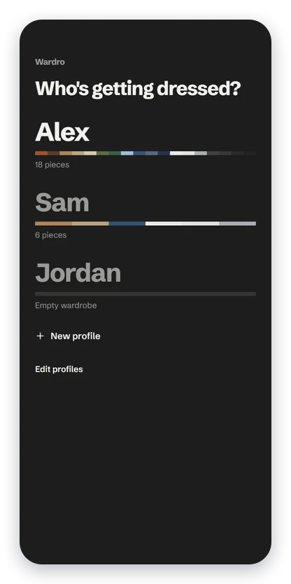
  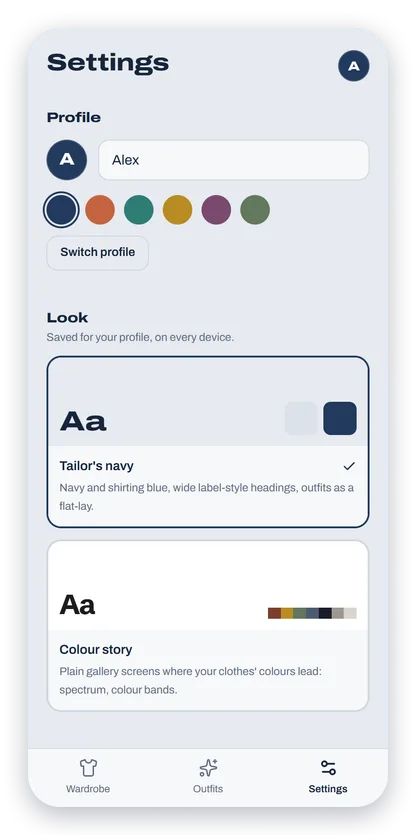
  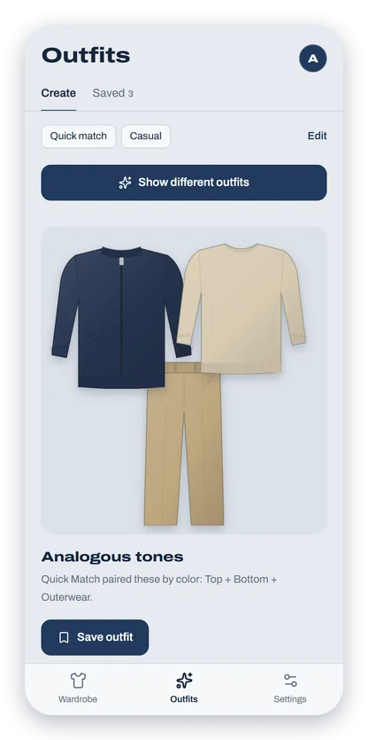
</p>

On a wider screen the bottom bar becomes a sidebar:

<p align="center">
  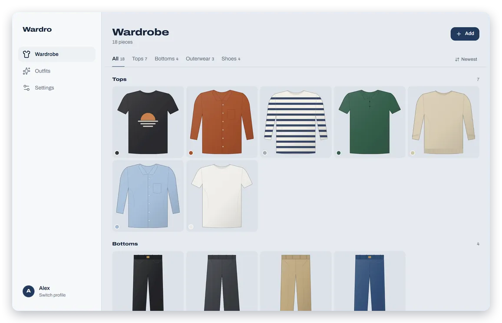
  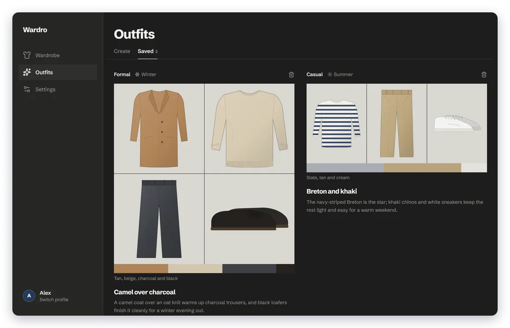
</p>

<sub>Screenshots use an illustrated demo wardrobe.</sub>

## 🧱 Architecture

Three containers (`docker-compose.yml`):

| Service | What | Notes |
|---|---|---|
| `web` | Next.js 16 app (UI + API routes), Node 24 | The only port published (3000) |
| `rembg` | Python/FastAPI background-removal sidecar | Internal only, runs as a non-root user |
| `db` | Postgres 16 | Internal only |

- **Storage:** wardrobe photos live on a Docker volume (`wardrobe-images`),
  one PNG per piece. The UI is served trimmed, downscaled WebP copies
  (about 90 KB instead of ~4 MB each), generated on first view and cached
  under `display/` on the same volume — safe to delete, they regenerate.
- **AI key:** `ANTHROPIC_API_KEY` is read only by the `web` container's
  server-side code (`lib/anthropic.ts`); it never reaches the browser.
- **Data model:** Prisma over Postgres — profiles, wardrobe items, saved
  outfits (`prisma/schema.prisma`). Migrations run automatically when the
  `web` container starts.

## 🚀 Running it

1. Copy the env template and fill in your Anthropic key:
   ```sh
   cp .env.example .env
   ```
2. Build and start everything:
   ```sh
   docker compose up --build -d
   ```
3. Open `http://localhost:3000` (or your Tailscale machine name/IP), add
   yourself on the profile screen, and start photographing.

Chrome and Edge can also **install** Wardro as its own app window — they
offer that only over HTTPS, so use the `tailscale serve` address described
under [iPhone and iPad](#-iphone-and-ipad).

**Upgrading?** Back up the database first — migrations run on start:

```sh
docker exec wardro-app-db-1 pg_dump -U wardro wardro > wardro-backup.sql
```

Upgrading from a version without profiles moves your existing wardrobe
into a profile called **"Me"** — rename it in Settings.

### Local development (without Docker)

Needs Node 24+, a local Postgres, and a running `rembg` sidecar (or point
`REMBG_URL` at one running elsewhere).

```sh
npm install
npx prisma migrate dev
npm run dev
```

## 📱 Android app

The APK is a thin [Capacitor](https://capacitorjs.com) shell: a native
WebView that loads the Wardro server over Tailscale. The UI isn't bundled
into it, so server updates (`docker compose up --build`) show up in the
app without rebuilding the APK. If the server can't be reached, the app
shows a "Can't reach Wardro" page with a retry button
(`android-shell/error.html`).

Needs Android Studio, or the Android SDK plus JDK 21.

1. Set where the phone should find the server in `.env` — your Docker
   host's Tailscale IP or MagicDNS name, plus the port:
   ```env
   WARDRO_SERVER_URL="http://100.x.y.z:3000"
   ```
   This is baked into the APK, so rebuild it if the address changes.
2. Build:

   | Command | What it does |
   | --- | --- |
   | `npm run android:sync` | Regenerate icons + error-page config and sync `android/` |
   | `npm run android:open` | Open the project in Android Studio |
   | `npm run android:apk` | Debug APK → `android/app/build/outputs/apk/debug/app-debug.apk` |
   | `npm run android:release` | Signed release APK → `android/app/build/outputs/apk/release/app-release.apk` |

3. Copy the APK to your phone and install it (allow installs from unknown
   sources). Tailscale must be connected on the phone.

Plain `http://` is fine — Tailscale encrypts the traffic — but the
WebView, like a browser, only allows "use my location" for weather on
`https://`. For that, put the server behind
[`tailscale serve`](https://tailscale.com/kb/1312/serve) and use its
`https://<machine>.<tailnet>.ts.net` URL; otherwise type the location in.

<details>
<summary><b>Signing a release APK</b></summary>

Release builds are signed using `android/keystore.properties`, which is
**gitignored**, as are all `*.jks`/`*.keystore` files:

```sh
keytool -genkeypair -v -keystore android/wardro-release.jks -storetype PKCS12 -alias wardro -keyalg RSA -keysize 4096 -validity 10000
```

```properties
storeFile=../wardro-release.jks
storePassword=your-store-password
keyAlias=wardro
keyPassword=your-key-password
```

Without this file, `android:release` still builds, but unsigned.

> **Back up the keystore and its password.** Android only accepts updates
> signed with the same key; lose it and you have to uninstall and
> reinstall the app.

</details>

## 🍎 iPhone and iPad

No App Store or build needed: Wardro runs from your server, so Safari adds
it to the home screen as a full-screen app with its own icon.

1. Install [Tailscale](https://tailscale.com/download/ios) on the iPhone
   and sign in to the same tailnet as your server.
2. In **Safari**, open your server's address (e.g. `http://100.x.y.z:3000`).
3. Tap **Share → Add to Home Screen**.

It then opens without Safari's toolbar, with the status bar matching your
look and theme. As on Android, plain `http://` works for everything except
"use my location" for weather — for that, run `tailscale serve --bg 3000`
on the server once and use its `https://<machine>.<tailnet>.ts.net`
address instead (or just type a city).

> A native iOS build isn't provided: it would need a Mac with Xcode, and
> without a paid Apple Developer account a self-installed app expires
> after 7 days. The home-screen app is the same experience — the Android
> APK is also just a window onto your server.

## 🔒 Access and privacy

Wardro is built for **personal use** — no accounts, no public
distribution. Access control is the network: keep port 3000 reachable only
over Tailscale (don't port-forward it to the internet). Within that:

- Profiles keep people's wardrobes apart but have no passwords, by design.
- The API refuses data-changing requests that a browser marks as coming
  from another site, so a web page you happen to open can't act on Wardro
  in the background.
- Uploads are size-limited (25 MB per photo) and checked to be images;
  security headers block framing and MIME sniffing.
- Photos stay on your server. They only leave it when you use the AI
  Stylist or Packing List, which send them to Anthropic's API.

## 📁 Project layout

```
app/                    Next.js App Router
  (shell)/               app shell (bottom bar / sidebar): wardrobe, outfits, settings
  profiles/              the profile picker
  manifest.ts            web app manifest (home-screen / "Install app")
  api/                   server routes: profiles, items, outfits, images, settings
components/             UI components, grouped by feature
lib/                    domain logic (colour harmony, Quick Match, colour names,
                        weather, AI Stylist, image store, profiles) + API client
proxy.ts                cross-site request guard for the API
prisma/                 data model and migrations
services/rembg/         the background-removal sidecar (FastAPI + rembg)
android/                Capacitor Android project (the APK)
android-shell/          pages bundled into the APK (offline error page)
scripts/                APK build helpers (server URL, icons, splash screens)
data/                   the Sanzo Wada colour dataset (see its LICENSE.md)
docs/screenshots/       README images
```

## ☕ Support

If Wardro App is useful to you, you can support its development on Ko-fi:

<p>
  <a href="https://ko-fi.com/crystaxit">
    
  </a>
</p>

## 📜 History

Wardro started as a Flutter app (Android + iOS) storing everything
on-device. It was rebuilt as this self-hosted web app to run from one
Docker host and be reachable from every device on a Tailscale network,
then gained profiles and its two looks — see [CHANGELOG.md](CHANGELOG.md).

Released under the [MIT License](LICENSE).
